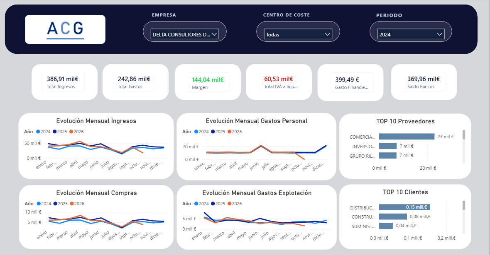

# Dashboard financiero para los clientes de una asesoría: de Microdata (Firebird) a Power BI

Este repositorio recoge la fase 1 de un proyecto de Business Intelligence que hice en mi trabajo en EVOTIC para una asesoría contable. La asesoría lleva la contabilidad de unas 500 empresas con Microdata, un software de contabilidad que guarda los datos en Firebird, y quería ofrecer a sus clientes un cuadro de mando con sus cifras clave: ingresos, gastos, margen, IVA a liquidar, saldo en bancos, evolución mensual y principales clientes y proveedores.

Hice el proyecto entero: el análisis del origen, la ETL en Python que vuelca Firebird a SQL Server, el modelo semántico y las medidas DAX, el diseño del informe, la validación de las cifras con la asesoría y la publicación en Power BI Service con actualización diaria automática.

Por privacidad he anonimizado la asesoría (el logo y el nombre "ACG" son inventados) y he sustituido todos los datos por **datos ficticios** generados con un script. El modelo, las relaciones, las consultas de Power Query, las medidas y el informe son los mismos que están en producción.



## Contexto

Microdata no guarda la contabilidad en una única base de datos:

- Hay un fichero `.FDB` por ejercicio (`2023.FDB`, `2024.FDB`, ...) y un `MICRO.FDB` con los datos maestros (empresas y sujetos).
- Dentro de cada ejercicio hay **una tabla por empresa** para cada concepto: `DIA00101` es el diario de la empresa 101, `MAY00101` su plan de cuentas con sumas mensuales, `CLA00101` sus claves analíticas (centros de coste), y así para las 470 empresas.
- El diario no trae asiento de apertura, pero sí los asientos técnicos de regularización (`TIPO = PERD`) y de cierre (`TIPO = CIER`) a 31 de diciembre.

El objetivo era juntar todo eso en un único modelo, con varios ejercicios a la vez, que se actualizara solo cada día y que permitiera a cada cliente consultar su IVA pendiente "a día de hoy", no solo al cerrar el trimestre.

## Herramientas

- **Python** (pandas, firebird-driver, SQLAlchemy, pyodbc): ETL de Firebird a SQL Server.
- **SQL Server Express**: base de datos intermedia en el servidor de la asesoría.
- **Programador de tareas de Windows**: ejecución diaria de la ETL (SQL Server Express no incluye el Agente de SQL Server).
- **Power BI Desktop** (Power Query, DAX): modelo semántico e informe.
- **Power BI Service** y **puerta de enlace de datos local**: publicación y actualización programada.

## Estructura del repositorio

```
.
├── 01_etl/
│   ├── etl_completo.py          ETL Firebird -> SQL Server que corre cada día en el servidor
│   ├── .env.example             Plantilla de configuración (rutas, servidor y credenciales)
│   └── requirements.txt
├── 02_datos_demo/
│   └── generar_datos_demo.py    Genera datos contables ficticios y los carga en SQL Server
├── 03_powerbi/
│   ├── Dashboard_Contable.pbix              Informe con los datos ficticios ya cargados, listo para abrir
│   ├── Dashboard_Contable.pbip              Proyecto de Power BI (el mismo informe en ficheros de texto)
│   ├── Dashboard_Contable.SemanticModel/    Modelo en TMDL: tablas, Power Query, relaciones y medidas
│   └── Dashboard_Contable.Report/           Informe en formato PBIR
└── docs/img/
```

El informe está en dos formatos. El `.pbix` lleva dentro los datos ficticios, así que se puede descargar y usar con todos sus filtros sin instalar nada más que Power BI Desktop. El **proyecto de Power BI (`.pbip`)** guarda el modelo y el informe en ficheros de texto: cada medida DAX y cada consulta de Power Query se puede leer directamente en GitHub (por ejemplo, en `03_powerbi/Dashboard_Contable.SemanticModel/definition/tables/Medidas.tmdl`).

## El proceso

### 1. Primera versión: CSV y Power BI

Empecé con una copia local de las bases de datos. Un script de Python leía las tablas de cada empresa y ejercicio, las unía y generaba tres CSV (`DIA_2026`, `MAY_2026` y `CLA_2026`) que Power BI cargaba con `Csv.Document`. Me sirvió para construir el modelo y validar las medidas, pero cada actualización era manual.

Los nombres de las tablas (`DIA_2026`, `MAY_2026`, `CLA_2026`) vienen de esa primera versión. Aunque contienen varios ejercicios, los mantuve en toda la migración para no tener que tocar el modelo ni las medidas.

### 2. Por qué no conecté Power BI directamente a Firebird

Probé a conectar Power BI por ODBC a Firebird y el refresco fallaba al combinar varias bases a la vez (`MICRO.FDB` y un ejercicio). Además, Firebird no permite consultas entre ficheros `.FDB` distintos, así que mantener varios ejercicios desde Power Query era frágil. Decidí poner una base de datos intermedia:

```
Firebird (Microdata, un .FDB por ejercicio)
    -> Python (ETL, abre cada .FDB de uno en uno)
    -> SQL Server Express (mismas tablas y columnas que el modelo)
    -> Power BI (conector nativo de SQL Server)
```

El proyecto no tenía presupuesto para licencias, así que todo se hizo con herramientas gratuitas, y el acceso al servidor de la asesoría era por escritorio remoto, sin VPN.

### 3. La ETL (`01_etl/etl_completo.py`)

El script se ejecuta cada día a las 06:00 desde el Programador de tareas del servidor:

1. **Ejercicios dinámicos.** Genera la lista de años desde 2023 hasta el año actual y, antes de abrir cada uno, comprueba que exista su `.FDB`. Si Microdata todavía no ha creado el ejercicio nuevo (por ejemplo, el 1 de enero), lo salta con un aviso en el log, no con un error. Así el año siguiente se incorpora solo, sin tocar el script.
2. **Unión de las tablas por empresa.** En cada ejercicio busca en `RDB$RELATIONS` todas las tablas que empiezan por `DIA`, `MAY` o `CLA`, las lee y añade dos columnas: `Año` y `Codigo_empresa`, que saca de los cinco últimos dígitos del nombre de la tabla.
3. **Limpieza.** Quita saltos de línea y tabulaciones de los textos, convierte a fecha las columnas que contienen `FECHA` e intenta convertir a número el resto.
4. **Carga.** Vacía cada tabla de destino con `TRUNCATE` y la vuelve a cargar en bloques de 5.000 filas con `fast_executemany`. Las tablas maestras (`EMPRESA` y `SUJETOS`), que son pequeñas, se reemplazan enteras.
5. **Control.** Cada ejecución deja un log diario y, si alguna tabla falla, un CSV con las incidencias. El script termina con código de salida 0 o 1 para que el Programador de tareas registre si fue bien.

En el repositorio las rutas, el servidor y las credenciales se leen de un fichero `.env` (ver `.env.example`) y he quitado el nombre del cliente de los mensajes del log. La lógica es la misma que la del script de producción.

### 4. Modelo semántico

| Tabla | Contenido |
|---|---|
| `DIA_2026` | Diario contable: un apunte por fila, todos los ejercicios y empresas |
| `MAY_2026` | Plan de cuentas por empresa y ejercicio, con el título de cada subcuenta (nombre del cliente o proveedor) |
| `CLA_2026` | Claves analíticas (centros de coste) |
| `MAY_INTERMEDIA` y `CLA_INTERMEDIA` | Tablas calculadas con la clave única de cuenta y de centro de coste |
| `Clientes_ACG` | Empresas de la asesoría: cruce en Power Query de `EMPRESA` con `SUJETOS` |
| `Calendario` | Generada en Power Query entre la primera y la última fecha del diario |
| `Medidas` | Tabla vacía que agrupa todas las medidas |

Un mismo número de cuenta o de centro de coste existe en todas las empresas y en todos los ejercicios, así que las relaciones usan **claves compuestas** `Año-Cuenta-Empresa` y `Año-Clave-Empresa`, calculadas en DAX. Las tablas intermedias evitan relaciones de varios a varios entre el diario y el plan de cuentas. Al principio la relación `DIA_2026 -> CLA_INTERMEDIA` filtraba en una sola dirección y el segmentador de centro de coste no respetaba la empresa seleccionada. La pasé a bidireccional, igual que la de `MAY_INTERMEDIA`.

En esta copia pública la conexión a SQL Server usa dos parámetros (`Servidor_SQL` y `Base_Datos_SQL`) para poder apuntar a cualquier servidor. El resto de pasos de Power Query son los de producción.

### 5. Medidas

Todas las medidas de explotación excluyen los asientos de regularización y cierre (`PERD` y `CIER`), porque son apuntes técnicos que dejan las cuentas a cero a final de año y anularían las cifras del ejercicio.

| Medida | Cuentas | Cálculo |
|---|---|---|
| Total Facturado | Grupo 7 | Haber - Debe |
| Total Gastos | Grupo 6 | Debe - Haber |
| Margen y % Margen | - | Facturado - Gastos, y su porcentaje sobre lo facturado |
| Gasto Personal | 640 y 642 | Debe - Haber |
| Evolucion_Compras | 600 a 612 (Aprovisionamientos) | Debe - Haber |
| Gasto_Explotación | 62 | Debe - Haber |
| Gasto Financiero | 66 | Debe - Haber |
| Saldo Bancos | 572 | Saldo a la fecha (ver abajo) |
| Total IVA a liquidar | 477, 472, 475, 4700 y 4709 | Ver abajo |
| Top y Ranking de clientes y proveedores | 430 y 400 | Volumen facturado por subcuenta |

**Total IVA a liquidar.** Fue la medida más difícil y la que más veces revisé con la asesoría. La primera versión restaba 477 - 472 acumulado desde enero y no cuadraba. Microdata registra cada trimestre un asiento `CIERRE IVA nT AAAA` que traspasa el saldo de 477 y 472 a la cuenta de Hacienda que toque: `475` si sale a pagar o `470` si sale a compensar o devolver. La medida final funciona así:

- **Trimestres ya cerrados:** toma solo los asientos `CIERRE IVA`. Suma lo que fue a la `475` en el periodo, sin acumular, porque se paga cada trimestre. Suma también lo que quedó en la `470` desde el último trimestre a pagar, porque ese importe se arrastra hasta que se compensa. Si una empresa registra el mismo trimestre un apunte en la 475 y otro en la 470, el arrastre de la 470 se reinicia; antes se sumaban los dos e inflaban todo el año.
- **Trimestre en curso (sin cierre todavía):** calcula en vivo 477 - 472 desde el inicio del trimestre hasta la fecha seleccionada y resta el IVA pendiente de compensar de la 4700/4709. Solo tiene en cuenta las subcuentas que han recibido algún `CIERRE IVA` de esa empresa, porque la 4709 también se usa para devoluciones del Impuesto de Sociedades, que no deben entrar. Como el diario no trae asiento de apertura, el saldo inicial lo saco del asiento de cierre (`CIER`) del 31 de diciembre anterior, con el signo cambiado.
- La fecha de referencia nunca pasa de hoy, y los periodos futuros quedan en blanco.

La validé al céntimo contra los importes de los modelos 303 que me pasó la asesoría para varias empresas y trimestres.

**Saldo Bancos.** Si el ejercicio seleccionado ya está cerrado, usa el asiento de cierre de la cuenta 572 como saldo real, porque es el conciliado con el banco. Si el ejercicio sigue abierto, usa el cierre del año anterior más los movimientos del año hasta la fecha.

**Meses futuros en las gráficas.** Las gráficas de evolución mensual comparan años, y el año en curso caía a cero en los meses que aún no han llegado. Las medidas de esas gráficas devuelven en blanco si el periodo empieza después de hoy. Para saber dónde empieza el periodo tuve que usar `CROSSFILTER(..., OneWay)`: con la relación bidireccional entre el diario y el calendario, el filtro de empresa recortaba el calendario a los días con apuntes y en un mes sin movimientos la fecha mínima salía vacía.

### 6. Informe

Una sola página con:

- Segmentadores de **empresa**, **centro de coste** y **periodo** (año, trimestre, mes y día).
- Tarjetas de **ingresos, gastos, margen** (con indicador de color), **IVA a liquidar**, **saldo en bancos** y **gasto financiero**.
- Cuatro gráficos de líneas con la **evolución mensual** de ingresos, gastos de personal, compras y gastos de explotación, un año por línea.
- **Top 10 de clientes y de proveedores** por volumen.


### 7. Publicación y actualización automática

Publiqué el informe en Power BI Service con una puerta de enlace de datos local instalada en el servidor de la asesoría. Cada día la ETL se ejecuta a las 06:00 y el modelo se actualiza a las 07:00, así que cualquier apunte nuevo en Microdata aparece en el informe al día siguiente sin intervención.

Para registrar la puerta de enlace tuve que resolver dos problemas:

- **DNS del servidor.** El DNS del router no respondía, aunque el navegador funcionaba porque usa DNS sobre HTTPS. Lo vi con `nslookup` y `Test-NetConnection` y lo resolví configurando un DNS público en el adaptador de red.
- **Tipo de cuenta.** La cuenta de Power BI se había creado como cuenta personal de Microsoft y la puerta de enlace exige una cuenta organizativa. El log mostraba un `404` en el descubrimiento del correo. La volví a crear desde el registro de Power BI, que crea el tenant correcto.

## Datos de demostración

El script `02_datos_demo/generar_datos_demo.py` crea 8 empresas inventadas con actividades distintas (distribución, taller, restauración, consultoría, inmobiliaria, ferretería, clínica dental y transporte) y genera su contabilidad desde 2023 hasta el día anterior:

- Facturas de venta y de compra con IVA, y sus cobros y pagos.
- Gastos de explotación, nóminas, seguros sociales, retenciones, intereses y comisiones.
- Asientos trimestrales `CIERRE IVA` contra la 475 o la 470, con compensación entre trimestres y devolución de AEAT meses después, como en los datos reales.
- Una devolución del Impuesto de Sociedades en la 4709, para comprobar que la medida de IVA la excluye.
- Regularización (`PERD`) y cierre (`CIER`) de cada ejercicio cerrado, sin asiento de apertura.

Genera los CSV y, con `--cargar`, crea las tablas en SQL Server con la misma estructura y tipos que deja la ETL. Así el informe se actualiza con las mismas consultas de Power Query que en producción.

## Problemas que tuve que resolver

- **Una tabla por empresa y un fichero por año.** La ETL descubre las tablas leyendo el catálogo de Firebird y saca el código de empresa del nombre de la tabla, así que una empresa nueva en Microdata entra sola.
- **El año nuevo.** La lista de ejercicios se genera con la fecha actual y los ejercicios que aún no existen se saltan sin error.
- **Conexiones concurrentes a Firebird desde Power BI.** Lo evité con la base intermedia en SQL Server y el conector nativo.
- **Claves que se repiten entre empresas y ejercicios.** Lo resolví con claves compuestas y tablas intermedias.
- **IVA.** Entender el asiento `CIERRE IVA` de Microdata y la diferencia entre IVA a compensar y devoluciones de otros impuestos, todo validado contra los modelos 303.
- **Gráficas engañosas.** Áreas apiladas que exageraban el crecimiento y meses futuros que caían a cero.
- **Infraestructura del cliente.** DNS roto, cuenta de Microsoft del tipo equivocado y SQL Server Express sin agente de tareas.

## Cómo ejecutarlo

La forma más rápida de verlo es descargar `03_powerbi/Dashboard_Contable.pbix` y abrirlo con [Power BI Desktop](https://www.microsoft.com/es-es/power-platform/products/power-bi/desktop) (gratuito, para Windows). Ya trae los datos ficticios cargados, así que se pueden usar los filtros de empresa, centro de coste y periodo sin conectarse a nada. Las medidas dependen de la fecha de hoy (por ejemplo, el IVA del trimestre en curso), por lo que con el paso del tiempo los datos de demostración irán quedando atrás. Para regenerarlos hasta el día actual:

1. Instalar las dependencias:
   ```
   pip install -r 01_etl/requirements.txt
   ```
2. Generar los datos y cargarlos en un SQL Server local (crea la base `BBDD_PowerBI` si no existe):
   ```
   python 02_datos_demo/generar_datos_demo.py --cargar --servidor localhost
   ```
3. Abrir `03_powerbi/Dashboard_Contable.pbip` con Power BI Desktop. Si el servidor no es `localhost`, cambiar el parámetro `Servidor_SQL` en Transformar datos > Administrar parámetros.
4. Pulsar **Actualizar** y entrar con las credenciales de Windows.

Para usar la ETL contra una instalación real de Microdata, copiar `01_etl/.env.example` a `01_etl/.env`, rellenar las rutas, el servidor y las credenciales, y ejecutar:

```
python 01_etl/etl_completo.py
```

## Otros proyectos de BI

Este es uno de varios proyectos de ETL y Power BI que he hecho para empresas de sectores distintos, con el mismo enfoque: sacar los datos de donde estén, moverlos a una base de datos propia en el servidor que toque y construir encima informes que se actualizan solos. Por ejemplo:

- **Una cadena de restaurantes:** ventas y reservas, con los datos de reservas extraídos de la API de CoverManager, e informes semanales y mensuales para la dirección.
- **Un grupo de clínicas y peluquerías con venta de producto en Amazon:** un informe de muchas páginas que junta la tienda física y el marketplace, con KPI de ventas, ticket medio, clientes nuevos y recurrentes, ocupación de agenda, stock y rentabilidad.

Esos proyectos no están publicados porque son datos de clientes.

## Qué no está en el repositorio

No he subido las bases de datos de Microdata, los CSV ni ningún dato de las empresas, las cifras usadas para validar las medidas, la documentación interna del cliente ni sus credenciales. El `.pbip` no incluye la caché de datos (`.pbi/cache.abf`). Los datos del `.pbix` y de la captura son los generados por el script de demostración.
